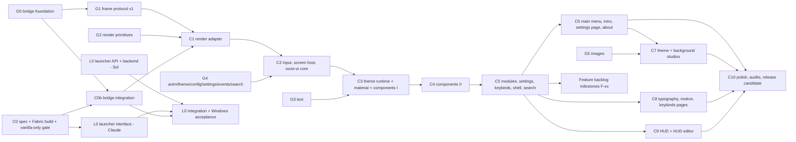

# Ooze Client — Milestone Implementation Plan

> Deliverable 15. Rewritten 2026-11-09 for the owner's decisions: Fabric 1.21.11, a Java 21 adapter, a Rust engine and UI, and Windows x64 first. Updated 2026-11-16 for the owner's decision to ship an **independent Ooze Launcher with its own Microsoft sign-in** (L-series).
> - **C-series:** Claude (Fabric integration, in-game Rust UI, product).
> - **G-series:** Sol (Rust engine, bridge, native artifacts, native CI).
> - **L-series:** the launcher; Claude (interface, product, accessibility, Fabric distribution inputs) and Sol (backend, auth, installer, process, packaging, launcher CI).
>
> Each milestone ends with a handoff in `docs/handoffs/` (AGENTS.md).

## 0. Working rules

1. **One milestone at a time per agent, committed on `main`** (AGENTS.md §Branches), ending with a handoff. Large milestones may be split (`C3a`, `C3b`).
2. **Dependencies are hard.** Don't start work that needs an unfinished dependency; do the independent parts and record the exact missing item.
3. **Gates are early and repeated.** Every milestone's acceptance list includes its own performance, accessibility and launch checks (§3). There is no "fix it all at the end" milestone.
4. **Evidence vocabulary:** Built, Headless-tested, Game-launched, Manually verified (AGENTS.md). A Windows claim needs Windows evidence.
5. **Real or absent.** Nothing user-visible ships before it works. Developer tools are dev-only. Samples are labelled.
6. **No invented bridge methods.** The C-series consumes Sol's published bridge API, and requests changes through handoffs. The launcher interface likewise consumes Sol's published launcher API; until it exists, the interface states its needs as a proposal (`docs/handoffs/CLAUDE-L0-request.md`) and develops against test-only fixtures.

## 1. Dependency graph

## 2. Milestones

### G-series (Sol): expected deliverables

The details are Sol's. Listed here so the C-series knows what it waits for.

| # | Deliverable the C-series depends on |
|---|---|
| **G0** | Cargo workspace and toolchain pin. `:bridge-java` Gradle project (Java 21, no Minecraft dependencies). Native loading with a status covering every state in TARGET_PLATFORM §5. Bridge and protocol version handshake. A **developer probe** round-trip call. A **Windows x64 native artifact** and its location. Protocol v0 document. Headless contract tests |
| **G1** | Frame protocol v1 meeting ARCHITECTURE §5.2: input batch, snapshot deltas, frame output (vertex streams, batches, texture work with byte sizes, platform commands). Validation helpers in bridge-java. Benchmarks (bytes per frame, per-call cost) |
| **G2** | Render primitives: tessellation, 1 px AA, superellipse, drips, shadows, gradients. Mesh cache with byte limits. Reference-rasterizer goldens |
| **G3** | Text: font registry, rasterization at physical px, atlas with a **byte budget**, layout and wrapping, the fallback-run list for the vanilla renderer |
| **G4** | Springs and tweens, theme resolution, configuration (atomic writes, migrations, backups excluding `backups/` and media), settings store, event bus, search index. **Config robustness tests are part of G4** |
| **G5** | Images: decode, mips, blur cache, luma and palette stats, a **byte-accurate** background texture accountant |
| **G6+** | More native platforms (each with an artifact **and** a launch test), CI performance tracking |

### C0 — Spec reconciliation, pinned Fabric build, vanilla-only gate (Claude)

**Depends on:** nothing.

**Tasks**
- [x] Reconcile AGENTS.md, ARCHITECTURE, REPOSITORY_STRUCTURE, TARGET_PLATFORM, this plan and TESTING with the 1.21.11 / Rust / launcher-authentication decisions.
- [x] Repair milestone dependencies (§4), stage early gates (§3), exclude backups from backup copies (ARCHITECTURE §9.5), and make texture budgets byte-based and enforceable (PERFORMANCE_AND_ACCESSIBILITY §2.2).
- [x] Pinned Gradle build: Gradle 9.8.2 (SHA-256), Loom remap 1.17.21, Mojang mappings, Loader 0.20.1, Fabric API 0.141.6+1.21.11, Java 21.
- [x] Fabric entrypoint with a Fabric-side engine port and gate, diagnostics, a vanilla toast notice, and a developer probe hook registered only with a loaded engine in development.
- [x] Headless tests (gate, fault injection, diagnostics, translations, source rules).
- [x] Game-launched test to the vanilla title screen in vanilla-only mode (Linux + Xvfb), with a screenshot and a vanilla Options round trip.
- [x] Review Sol's G0 and integrate it:
  - `:bridge-java` merged once into the mod JAR, with the Windows x64 DLL from Sol's CI artifact;
  - `BridgeEngineConnector` over `NativeLoader.tryLoad`;
  - dev-only probe plus `BridgeDiagnosticScreen` (input batches, fixture, eager lease copy, vanilla GUI render state).
  
  Game-launched on Linux, where the real state is `UNSUPPORTED_PLATFORM`.

**Gate A (C0):** Built; Headless-tested; Game-launched on Linux (vanilla-only, real bridge loader, fault-injected states, production JAR). **Passed.**

### C0b — Windows verification of the integrated bridge (Claude, with a Windows host)

**Depends on:** C0 (done), a Windows x64 machine or CI runner.

Integration code is complete (C0). What remains is evidence, plus follow-ups to Sol's review items:
- [ ] Run `OOZE_NATIVE_RESOURCES=<dir> tools/launch-tests.sh` on Windows x64 (Git Bash); commit the evidence.
- [ ] Replace `BridgeStatusMapper`'s text classification with Sol's structured reason once it is provided.

**Gate B:**
- **Game-launched on Windows x64**, all of:
  - the title screen is reached;
  - the probe round trip succeeds and its timing is logged;
  - with the DLL removed → `MISSING_LIBRARY` diagnostic and vanilla usable;
  - with a version-mismatched DLL → `INCOMPATIBLE` diagnostic and vanilla usable.
- **Game-launched on Linux:** the bundled JAR reports `MISSING_LIBRARY` or `UNSUPPORTED_PLATFORM` and vanilla is usable.

### C1 — Java render adapter (Claude)

**Depends on:** C0b, G1, G2.

- [ ] Frame output validation: header, version, bounds, counts, byte sizes.
- [ ] GUI element render states: derived TRIANGLES pipelines with the degenerate-quad fallback; scissor; the px → GUI scale.
- [ ] Texture executor (create, upload, destroy) with an independent **byte budget** check and diagnostics.
- [ ] Ordering investigation (ARCHITECTURE §5.9), then the `layerBreak` implementation.
- [ ] Dev-only **Render Lab** screen showing engine primitives.
- [ ] Source-rule test covering `render/`.

**Gate C (early render gate):**
- the ordering torture golden passes;
- the crispness checklist (TESTING §5) passes at window sizes 1920×1080, 2560×1440 and 3840×2160;
- ≤ 2 JNI calls per frame, measured;
- Java submit time within PERFORMANCE_AND_ACCESSIBILITY §2.1;
- Game-launched on Windows x64.

### C2 — Input, screen host, snapshots, commands; `ooze-ui` core (Claude)

**Depends on:** C1, G4.

- [ ] `OozeScreenHost` with input capture and batching (keys, chars, mouse, scroll, file drop) and the focus and modality header.
- [ ] Snapshot producers (window, options, language and translations table, narrator state, display identity: **username and UUID only**).
- [ ] Platform command executor (close, narrate, cursor, clipboard, play click).
- [ ] `native/crates/ooze-ui`: node tree, layout, focus scopes, roving focus, layers, router, Esc chain, narration info. A dev test screen.

**Gate D (early accessibility gate):**
- keyboard-only navigation and the Esc chain pass in a scripted gametest;
- narration is spoken for focus changes (Manually verified, Windows Narrator plus Minecraft narrator on);
- input to visual response within the same frame.

### C3 — Theme runtime, Ooze material, components I (Claude)

**Depends on:** C2, G3, G4.

- [ ] Theme tokens from `assets-src/themes/` through the resource contract; built-in themes validate with zero contrast failures.
- [ ] The **theme runtime is introduced here, before components** (this repairs the old ordering, §4).
- [ ] Material painter (DESIGN_SYSTEM §3); focus ring; interaction states.
- [ ] Components C01–C09, C14, C19, C22, C25, C28, with motion, reduced motion, Off and keyboard support. Dev-only **Component Gallery**.

**Gate E (visual identity gate):**
- Gallery goldens at three window sizes in light and dark themes;
- owner review of screenshots: **Manually verified** sign-off before C4 scales the library;
- per-scene performance budget met.

### C4 — Components II (Claude)

**Depends on:** C3.

- C10–C13, C15–C18, C20–C21, C23–C24, C26–C27, C29–C31, C33–C34.
- **Gate:** the COMPONENTS §13 matrix verified in the Gallery; overlay focus-trap tests; the performance budget.

### C5 — Modules, settings, keybinds, shell, search (Claude)

**Depends on:** C4, G4. *(2026-11-17: the module runtime moved to M0 and real modules to M2/M3; C5 keeps the shell, palette and ClickGUI. The sample modules are dropped now that real modules are authorised.)*

- [ ] Shell (S03) with sidebar, cards, inspector and filters.
- [ ] Command palette (S11).
- [ ] Core key mapping "Open ClickGUI" (Right Shift).
- [ ] Module binds from the input batch.
- [ ] Java hook layer for game-facing module actions.
- [ ] Sample modules: Settings Showcase and Notification Playground (labelled Sample).

**Gate:**
- flows F2, F3, F8 and F9 run as scripted gametests;
- the configuration crash test (TESTING §7) passes against G4's store;
- Game-launched on Windows x64.

### C6 — Main menu, intro, welcome, settings page, about, compatibility (Claude)

**Depends on:** C5.

- Title-screen interception (a `require = 0` mixin with the Fabric screen-event fallback). Vanilla accessibility onboarding is preserved.
- S01, S02 (including the compatibility tray and Mod Menu), S04, S12.
- **Gate:** every vanilla title-screen function is reachable (scripted); F1 and F10 pass.

### C7 — Theme Studio and Background Studio (Claude)

**Depends on:** C6, G5.

- S05 and S06, including import (Java tinyfd, drag and drop, inbox folder), the legibility guard and **byte budgets** (BACKGROUNDS §4.5).
- **Gate:** F4 and F5 pass; importing a 4K PNG stays within the frame budget; the background budget is never exceeded (asserted).

### C8 — Typography, Motion and Keybinds pages; adaptive governor (Claude)

**Depends on:** C5, plus G3 (typography) and G4 (motion). It can run in parallel with C6 and C7.

- S07, S08, S10; the adaptive quality governor.
- **Gate:** F6 passes; the governor demotes and promotes with hysteresis in the benchmark scene.

### C9 — HUD and HUD editor (Claude)

**Superseded by M1 (2026-11-17).** Kept for reference.

**Depends on:** C5 and C1. It no longer waits for the typography or motion pages.

- Java HUD hook through Fabric API's HUD element registry.
- Rust HUD composition; S09 editor; sample widgets (FPS, Clock, Watermark) labelled Sample.
- **Gate:** F7 passes; HUD ≤ 0.25 ms total and zero steady-state allocation (Java side measured, Rust side reported); layouts survive resolution changes.

### C10 — Polish, audits, release candidate (Claude, with Sol for artifacts and CI)

**Depends on:** C6–C9.

- Drip lifecycles, breathing edges, surface tension.
- Full accessibility audit; robustness suite; licences; the Windows x64 release JAR.
- Install documentation verified on a clean Windows machine with the Ooze Launcher (and the manual official-launcher route in INSTALL.md).
- **Gate:** TESTING §10 holds for the codebase; Manually verified install on Windows x64.

### L-series: the Ooze Launcher

#### L0 — Usable Windows x64 launcher: sign-in to Play (Claude interface + Sol backend)

**Depends on:** C0 (Fabric build, launch tests), Sol's `LAUNCHER_API_V1` and backend, C0b's Windows DLL evidence for the real-DLL acceptance.

**Claude delivers:**
- `launcher/crates/ooze-launcher-ui`: the egui/eframe window with first run, Play, Settings, Diagnostics and the close prompt (docs/launcher/LAUNCHER_UI.md).
  - Tokens from the shared theme; Bubblegum Sans + Inter (OFL); en_us strings.
  - Full / Reduced / Off motion; AccessKit names, roles, values and live status; keyboard-only operation.
  - Defence-in-depth redaction.
- Fixtures under `cfg(test)` / `dev-fixtures` only (release builds refuse the feature).
- Fabric distribution inputs:
  - `build/dist/ooze-launcher-profile.json` (pinned profile + checksums);
  - the `OOZE_READY v1` title-screen marker in the mod, asserted by every launch test.
- Reconciled specs; review of Sol's backend; `docs/handoffs/CLAUDE-L0.md`.

**Sol delivers:**
- `LAUNCHER_API_V1` and `ooze-launcher-core`:
  - browser + PKCE sign-in with the owned public client ID; Xbox/XSTS/Minecraft Services; entitlement; refresh; DPAPI credential storage;
  - installer and verifier (Mojang manifest, Fabric profile, Fabric API, Ooze JAR, Java 21);
  - process lifecycle with `OOZE_READY` detection; redacted logs and diagnostics export.
- `ooze-launcher-cli`, workspace, packaging, launcher CI, `AUTH_SETUP.md`, `BUILD_AND_TEST.md`, `docs/handoffs/SOL-L0.md`.

**Acceptance (Gate L):** see §3. External prerequisites that may block it are recorded honestly:
- the owned Microsoft public client ID (app registration);
- Minecraft Services approval for that app;
- a legitimately entitled Microsoft account;
- a Windows x64 machine.

#### Owner scope expansion (2026-11-17)

The owner authorised real client modules, FPS/PvP/Minimal profiles, multiple isolated instances, Modrinth content (mods, resource packs, data packs, shader packs), customisable themes and installation integrity. The milestones below replace "L1+ (not planned in detail)".

**Owner decision (2026-11-25):** Ooze ships without built-in anti-cheat. Managed Fair Play and instance modes are removed; every instance is a normal instance where players add compatible mods and packs. File verification and Repair stay. Module classes, the GAMEPLAY block and the excluded list are unchanged.

- **Backend contract:** Sol's `docs/launcher/LIBRARY_API_V1.md` (Library API 1, alongside Launcher API 1).
- **Product definitions:** `docs/MODULES.md` and `docs/launcher/LIBRARY_UI.md`.

#### P0 — Product reconciliation, module model, contract alignment (Claude) ✓ in progress 2026-11-17

- Sourced module matrix and fair-play policy (`docs/MODULES.md`).
- `native/crates/ooze-ui`: module catalog, typed settings, presets, profile layering and diff, HUD layout, CPS and frame statistics. Headless-tested.
- Specs reconciled; library UI specified; contract alignment requests to Sol (`CLAUDE-P0-request.md`).
- Launcher screens for instances, profiles, themes, content and integrity. These are built and Headless-tested over test fixtures, and **hidden in release until the library reports each capability**.

#### L1 — First library integration (Sol backend + Claude UI)

**Depends on:** Library API 1 implementation (Sol), P0.

- The packaged launcher lists, creates, renames and duplicates **isolated Fabric 1.21.11 instances** (Vanilla 1.21.11 too, if Sol's adapter is verified).
  - Selecting an instance for Play goes through API 1 `SaveSettings` + `Launch`.
- FPS / PvP / Minimal profiles per instance: what each changes, user overrides, reset, duplicate, export and import. Persisted by the library and validated with `ooze-ui`'s catalog.
- A persisted, validated theme with live preview, reset, import and export.
- Real Modrinth search, details and versions for the selected instance.
- **One complete content flow:** a Fabric 1.21.11 mod with required dependencies → dependency review → install with progress and cancellation → installed-content list.
- **Gate:**
  - Built and Headless-tested (Linux and Windows CI);
  - Game-launched (Windows x64): the installed mod loads in the selected instance and `OOZE_READY` is logged;
  - Manually verified: Narrator over the new screens.

#### L2 — Content types, installed content, file verification (Sol + Claude)

**Depends on:** L1.

- Resource packs.
- Data packs, with an explicitly selected existing local world; refused while the game runs.
- Shader packs, with the compatible shader loader checked; installed ≠ enabled.
- Updates, disable and removal of recorded files only.
- File verification with concrete failures (changed or missing files, game installation) and safe repair, never automatic deletion. One instance experience, no modes.
- **Gate:** Game-launched per content type on Windows x64. File-verification failure scenarios are Headless-tested.

#### L3 — More versions and loaders (Sol + Claude)

**Depends on:** L2.

- Only combinations whose install adapter and launch test exist on Windows x64 are exposed.
- Each instance shows whether Ooze modules are available.

#### MV — Minecraft 1.21.11 and 26.1–26.3 (owner brief 2026-11-26; Claude mod and interface + Sol backend)

- **Claude:** Fabric adapters for 1.21.11 (kept) and the 26.1, 26.2 and 26.3 families with shared Java (`versions/common`, `versions/mc26`); production JARs with exact `minecraft` lists; per-version launcher profiles; the launch matrix for every target (`tools/launch-tests.sh`); Vanilla and Fabric version selection, the Play target and the content target in the launcher interface. Delivered in `docs/handoffs/CLAUDE-MV.md`.
- **Sol:** install adapters, capabilities, the planner's Fabric API pin, Play for the instance's own target, packaging and Windows `engine=LOADED` evidence (`docs/handoffs/CLAUDE-MV-request.md`).
- **Gate:** every advertised Fabric target Game-launched on Windows x64 with its shipped JAR to `OOZE_READY v1 screen=title engine=LOADED`, and vanilla Options working with the engine unavailable (real DLL failure cases); launcher version selection Headless-tested and Manually verified with keyboard and Narrator on Windows.

### In-game module milestones (revised dependencies, 2026-11-17)

The module framework work formerly in C5 and C9 is split so modules land in reviewable steps. The P0 model crate already holds the catalog, settings, profiles and HUD geometry.

| Milestone | Delivers | Depends on |
|---|---|---|
| **M0** module runtime | Module registry and enable state from the instance profile; settings persistence through Sol's G4 store; module keybinds from the input batch (only with no screen open); fair-play gate (no GAMEPLAY); per-module failure isolation | C2 (input, snapshots), G1 (frame protocol), G4 (config store), P0 |
| **M1** HUD and HUD editor | Java HUD hook (Fabric HUD element registry); Rust composition from `ooze-ui::hud`; editor with anchors, snapping, scaling, keyboard nudge, reset; ≤ 0.25 ms for three widgets | C1 (render adapter), C3 (components), M0 |
| **M2** information modules | M-01 FPS and frame time, M-02 coordinates and facing, M-03 armour (needs the vanilla item-icon command in the protocol), M-04 effects (effect-icon command), M-05 keystrokes, M-06 CPS, M-07 ping | M1; Sol: snapshot fields and icon commands |
| **M3** zoom and crosshair | M-08 hold-to-zoom (FOV hook, `require = 0`), M-09 custom crosshair (Fabric HUD replacement) | M1 |

Every M milestone gate:
- Game-launched on Windows x64 and Linux;
- settings persist;
- keyboard and narration;
- reduced motion and Off;
- vanilla unchanged when the module is off;
- no allocation in steady-state HUD frames.

### Feature backlog milestones (F-xx)

Real modules come from `docs/FEATURE_BACKLOG.md`, one entry per milestone, after C5. Each entry names its fair-play class, the Java hooks it needs, the Rust settings and UI, its tests and its acceptance criteria. **The framework samples are not a finished client.**

## 3. Staged acceptance gates

| Gate | Milestone | Checks | Evidence required |
|---|---|---|---|
| A | C0 | Build, unit tests, vanilla-only launch to the title screen | Built, Headless-tested, Game-launched (Linux) |
| B | C0b | Native round trip; missing and incompatible DLLs | Game-launched (**Windows x64**) |
| C | C1 | Ordering golden, crispness ×3 sizes, JNI calls per frame, submit time | Headless-tested + Game-launched (Windows) |
| D | C2 | Keyboard and Esc chain, narration, same-frame input | Game-launched + Manually verified (narration) |
| E | C3 | Visual identity sign-off, light and dark goldens | Manually verified (owner) |
| Perf | Every milestone ≥ C1 | The scenes it adds stay within PERFORMANCE_AND_ACCESSIBILITY §2 | Measured tables in the handoff |
| A11y | Every UI milestone ≥ C2 | Keyboard, focus-visible, reduced motion and Off for everything new | Scripted gametest + checklist |
| Launch | Every milestone | Windows x64 smoke launch (from C0b), Linux vanilla-only smoke | Game-launched |
| L | L0 | Packaged launcher on a clean Windows x64 install dir: • entitled-account browser sign-in, cancel and retry • real install, network loss and retry, repair preserving `saves/` and `options.txt` • Play → Fabric 1.21.11 on Java 21 → `OOZE_READY … engine=LOADED` • exit, restart, relaunch on refreshed credentials • exported diagnostics contain no tokens • Narrator walkthrough | Built (package) + Game-launched (Windows x64) + Manually verified (Narrator); interface Headless-tested on every change |

## 4. Dependency repairs relative to the previous plan

| Problem in the old plan | Repair |
|---|---|
| Components (old M5) used theme tokens before the theme system existed (old M7) | Theme runtime is part of **C3**, before the components; only the Theme Studio UI stays later (C7) |
| HUD (old M12) waited for the typography and motion pages (old M11) | **C9** depends only on C5 and C1 |
| Typography and motion pages (old M11) waited for the main menu (old M10) | **C8** depends on C5 (plus G3/G4) and runs in parallel with C6 and C7 |
| Performance, cross-version and accessibility checks came only at the end (old M13/M14) | Staged gates A–E plus per-milestone Perf/A11y/Launch gates (§3) |
| Config robustness tested only in the release milestone | Moved to **G4** (store) and C5 (crash test against the real store) |
| Texture memory checked only in the final performance pass | Byte budgets are enforced from C1 (Java executor) and G3/G5 (Rust accountants) |
| Multi-target and Vulkan verification at old M13 | Removed with the 26.x targets; platform gates are Windows x64 (C0b onwards) |

## 5. Risk register

| Risk | Impact | Mitigation |
|---|---|---|
| G0 is late | C0b, C1 and everything after are blocked | C0 completed independently; requests to Sol recorded in `docs/handoffs/CLAUDE-C0.md` |
| No Windows host for Claude | C0b and Gate L can't be evidenced | Requested Windows CI from Sol and Sol; the joint acceptance run is scripted in `CLAUDE-L0-request.md` §4 |
| JNI overhead or frame size | Frame time | One call per frame, direct buffers, measured in G1 and C1 gates |
| GUI render-state ordering | Layering bugs | C1 investigation and golden |
| Windows-only native support in early milestones | Linux and macOS users get vanilla-only mode | A clear diagnostic; platforms are added only with artifacts and launch tests |
| Native crash takes down the game | Lost session | Sol's bridge rule: no panics across FFI; fault isolation tests in G0/G1 |
| Font licences | Legal | Unmodified files, OFL texts, attribution UI |
| No owned Microsoft client ID, or Minecraft Services has not approved the app | The launcher cannot sign anyone in | Typed `AuthNotConfigured` / `AuthAppNotApproved` errors with honest copy; never an offline fallback; the blocker is recorded in the L0 handoffs |
| Launcher API published late | The L0 interface can't integrate | The interface states its needs (`CLAUDE-L0-request.md`) and uses test-only fixtures; one adapter file changes on integration |
