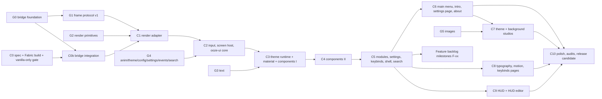

# Ooze Client — Milestone Implementation Plan

> Deliverable 15. Rewritten 2026-11-09 for the owner's decisions: Fabric 1.21.11, a Java 21 adapter, a Rust engine and UI, authentication through the launcher, and Windows x64 first.
> - **C-series:** Claude (Fabric integration, Rust UI, product).
> - **G-series:** Sol (Rust engine, bridge, native artifacts, CI).
>
> Each milestone ends with a handoff in `docs/handoffs/` (AGENTS.md).

## 0. Working rules

1. **One milestone per branch or PR**, ending with a handoff. Large milestones may be split (`C3a`, `C3b`).
2. **Dependencies are hard.** Don't start work that needs an unfinished dependency; do the independent parts and record the exact missing item.
3. **Gates are early and repeated.** Every milestone's acceptance list includes its own performance, accessibility and launch checks (§3). There is no "fix it all at the end" milestone.
4. **Evidence vocabulary:** Built, Headless-tested, Game-launched, Manually verified (AGENTS.md). A Windows claim needs Windows evidence.
5. **Real or absent.** Nothing user-visible ships before it works. Developer tools are dev-only. Samples are labelled.
6. **No invented bridge methods.** The C-series consumes Sol's published bridge API, and requests changes through handoffs.

## 1. Dependency graph

## 2. Milestones

### G-series (Sol): expected deliverables

The details are Sol's. Listed here so the C-series knows what it waits for.

| # | Deliverable the C-series depends on |
|---|---|
| **G0** | Cargo workspace and toolchain pin. `:bridge-java` Gradle project (Java 21, no Minecraft dependencies). Native loading with a status covering every state in TARGET_PLATFORM §5. Bridge and protocol version handshake. A **developer probe** round-trip call. A **Windows x64 native artifact** and its location. Protocol v0 document. Headless contract tests |
| **G1** | Frame protocol v1 meeting ARCHITECTURE §5.2: input batch, snapshot deltas, frame output (vertex streams, batches, texture work with byte sizes, platform commands). Validation helpers in bridge-java. Benchmarks (bytes per frame, per-call cost) |
| **G2** | Render primitives: tessellation, 1 px AA, superellipse, drips, shadows, gradients. Mesh cache with byte limits. Reference-rasterizer goldens |
| **G3** | Text: font registry, rasterization at physical px, atlas with a **byte budget**, layout and wrapping, the fallback-run list for the vanilla renderer |
| **G4** | Springs and tweens, theme resolution, configuration (atomic writes, migrations, backups excluding `backups/` and media), settings store, event bus, search index. **Config robustness tests are part of G4** |
| **G5** | Images: decode, mips, blur cache, luma and palette stats, a **byte-accurate** background texture accountant |
| **G6+** | More native platforms (each with an artifact **and** a launch test), CI performance tracking |

### C0 — Spec reconciliation, pinned Fabric build, vanilla-only gate (Claude)

**Depends on:** nothing.

**Tasks**
- [x] Reconcile AGENTS.md, ARCHITECTURE, REPOSITORY_STRUCTURE, TARGET_PLATFORM, this plan and TESTING with the 1.21.11 / Rust / launcher-authentication decisions.
- [x] Repair milestone dependencies (§4), stage early gates (§3), exclude backups from backup copies (ARCHITECTURE §9.5), and make texture budgets byte-based and enforceable (PERFORMANCE_AND_ACCESSIBILITY §2.2).
- [x] Pinned Gradle build: Gradle 9.8.2 (SHA-256), Loom remap 1.17.21, Mojang mappings, Loader 0.20.1, Fabric API 0.141.6+1.21.11, Java 21.
- [x] Fabric entrypoint with a Fabric-side engine port and gate, diagnostics, a vanilla toast notice, and a developer probe hook registered only with a loaded engine in development.
- [x] Headless tests (gate, fault injection, diagnostics, translations, source rules).
- [x] Game-launched test to the vanilla title screen in vanilla-only mode (Linux + Xvfb), with a screenshot and a vanilla Options round trip.
- [ ] Integrate Sol's bridge and the Windows x64 artifact. **Moved to C0b**, blocked on G0.

**Gate A (C0):** Built; Headless-tested; Game-launched on Linux in vanilla-only mode for `NOT_BUNDLED` plus at least one fault-injected state.

### C0b — Bridge integration (Claude)

**Depends on:** G0, C0.

- [ ] Review Sol's G0 diff and record findings in the handoff **before** integrating.
- [ ] Implement the single `EngineConnector` adapter over the agreed bridge-java API; map its states to TARGET_PLATFORM §5.
- [ ] Package bridge-java and the Windows x64 native artifact into the JAR (the path agreed in G0); record the JAR byte size.
- [ ] Wire the developer probe (F9, development only) to the bridge's probe call.

**Gate B:**
- **Game-launched on Windows x64**, all of:
  - the title screen is reached;
  - the probe round trip succeeds and its timing is logged;
  - with the DLL removed → `MISSING_LIBRARY` diagnostic and vanilla usable;
  - with a version-mismatched DLL → `INCOMPATIBLE` diagnostic and vanilla usable.
- **Game-launched on Linux:** the bundled JAR reports `MISSING_LIBRARY` or `UNSUPPORTED_PLATFORM` and vanilla is usable.

### C1 — Java render adapter (Claude)

**Depends on:** C0b, G1, G2.

- [ ] Frame output validation: header, version, bounds, counts, byte sizes.
- [ ] GUI element render states: derived TRIANGLES pipelines with the degenerate-quad fallback; scissor; the px → GUI scale.
- [ ] Texture executor (create, upload, destroy) with an independent **byte budget** check and diagnostics.
- [ ] Ordering investigation (ARCHITECTURE §5.9), then the `layerBreak` implementation.
- [ ] Dev-only **Render Lab** screen showing engine primitives.
- [ ] Source-rule test covering `render/`.

**Gate C (early render gate):**
- the ordering torture golden passes;
- the crispness checklist (TESTING §5) passes at window sizes 1920×1080, 2560×1440 and 3840×2160;
- ≤ 2 JNI calls per frame, measured;
- Java submit time within PERFORMANCE_AND_ACCESSIBILITY §2.1;
- Game-launched on Windows x64.

### C2 — Input, screen host, snapshots, commands; `ooze-ui` core (Claude)

**Depends on:** C1, G4.

- [ ] `OozeScreenHost` with input capture and batching (keys, chars, mouse, scroll, file drop) and the focus and modality header.
- [ ] Snapshot producers (window, options, language and translations table, narrator state, display identity: **username and UUID only**).
- [ ] Platform command executor (close, narrate, cursor, clipboard, play click).
- [ ] `native/crates/ooze-ui`: node tree, layout, focus scopes, roving focus, layers, router, Esc chain, narration info. A dev test screen.

**Gate D (early accessibility gate):**
- keyboard-only navigation and the Esc chain pass in a scripted gametest;
- narration is spoken for focus changes (Manually verified, Windows Narrator plus Minecraft narrator on);
- input to visual response within the same frame.

### C3 — Theme runtime, Ooze material, components I (Claude)

**Depends on:** C2, G3, G4.

- [ ] Theme tokens from `assets-src/themes/` through the resource contract; built-in themes validate with zero contrast failures.
- [ ] The **theme runtime is introduced here, before components** (this repairs the old ordering, §4).
- [ ] Material painter (DESIGN_SYSTEM §3); focus ring; interaction states.
- [ ] Components C01–C09, C14, C19, C22, C25, C28, with motion, reduced motion, Off and keyboard support. Dev-only **Component Gallery**.

**Gate E (visual identity gate):**
- Gallery goldens at three window sizes in light and dark themes;
- owner review of screenshots: **Manually verified** sign-off before C4 scales the library;
- per-scene performance budget met.

### C4 — Components II (Claude)

**Depends on:** C3.

- C10–C13, C15–C18, C20–C21, C23–C24, C26–C27, C29–C31, C33–C34.
- **Gate:** the COMPONENTS §13 matrix verified in the Gallery; overlay focus-trap tests; the performance budget.

### C5 — Modules, settings, keybinds, shell, search (Claude)

**Depends on:** C4, G4.

- [ ] Shell (S03) with sidebar, cards, inspector and filters.
- [ ] Command palette (S11).
- [ ] Core key mapping "Open ClickGUI" (Right Shift).
- [ ] Module binds from the input batch.
- [ ] Java hook layer for game-facing module actions.
- [ ] Sample modules: Settings Showcase and Notification Playground (labelled Sample).

**Gate:**
- flows F2, F3, F8 and F9 run as scripted gametests;
- the configuration crash test (TESTING §7) passes against G4's store;
- Game-launched on Windows x64.

### C6 — Main menu, intro, welcome, settings page, about, compatibility (Claude)

**Depends on:** C5.

- Title-screen interception (a `require = 0` mixin with the Fabric screen-event fallback). Vanilla accessibility onboarding is preserved.
- S01, S02 (including the compatibility tray and Mod Menu), S04, S12.
- **Gate:** every vanilla title-screen function is reachable (scripted); F1 and F10 pass.

### C7 — Theme Studio and Background Studio (Claude)

**Depends on:** C6, G5.

- S05 and S06, including import (Java tinyfd, drag and drop, inbox folder), the legibility guard and **byte budgets** (BACKGROUNDS §4.5).
- **Gate:** F4 and F5 pass; importing a 4K PNG stays within the frame budget; the background budget is never exceeded (asserted).

### C8 — Typography, Motion and Keybinds pages; adaptive governor (Claude)

**Depends on:** C5, plus G3 (typography) and G4 (motion). It can run in parallel with C6 and C7.

- S07, S08, S10; the adaptive quality governor.
- **Gate:** F6 passes; the governor demotes and promotes with hysteresis in the benchmark scene.

### C9 — HUD and HUD editor (Claude)

**Depends on:** C5 and C1. It no longer waits for the typography or motion pages.

- Java HUD hook through Fabric API's HUD element registry.
- Rust HUD composition; S09 editor; sample widgets (FPS, Clock, Watermark) labelled Sample.
- **Gate:** F7 passes; HUD ≤ 0.25 ms total and zero steady-state allocation (Java side measured, Rust side reported); layouts survive resolution changes.

### C10 — Polish, audits, release candidate (Claude, with Sol for artifacts and CI)

**Depends on:** C6–C9.

- Drip lifecycles, breathing edges, surface tension.
- Full accessibility audit; robustness suite; licences; the Windows x64 release JAR.
- Install documentation verified on a clean Windows machine with the official launcher.
- **Gate:** TESTING §10 holds for the codebase; Manually verified install on Windows x64.

### Feature backlog milestones (F-xx)

Real modules come from `docs/FEATURE_BACKLOG.md`, one entry per milestone, after C5. Each entry names its fair-play class, the Java hooks it needs, the Rust settings and UI, its tests and its acceptance criteria. **The framework samples are not a finished client.**

## 3. Staged acceptance gates

| Gate | Milestone | Checks | Evidence required |
|---|---|---|---|
| A | C0 | Build, unit tests, vanilla-only launch to the title screen | Built, Headless-tested, Game-launched (Linux) |
| B | C0b | Native round trip; missing and incompatible DLLs | Game-launched (**Windows x64**) |
| C | C1 | Ordering golden, crispness ×3 sizes, JNI calls per frame, submit time | Headless-tested + Game-launched (Windows) |
| D | C2 | Keyboard and Esc chain, narration, same-frame input | Game-launched + Manually verified (narration) |
| E | C3 | Visual identity sign-off, light and dark goldens | Manually verified (owner) |
| Perf | Every milestone ≥ C1 | The scenes it adds stay within PERFORMANCE_AND_ACCESSIBILITY §2 | Measured tables in the handoff |
| A11y | Every UI milestone ≥ C2 | Keyboard, focus-visible, reduced motion and Off for everything new | Scripted gametest + checklist |
| Launch | Every milestone | Windows x64 smoke launch (from C0b), Linux vanilla-only smoke | Game-launched |

## 4. Dependency repairs relative to the previous plan

| Problem in the old plan | Repair |
|---|---|
| Components (old M5) used theme tokens before the theme system existed (old M7) | Theme runtime is part of **C3**, before the components; only the Theme Studio UI stays later (C7) |
| HUD (old M12) waited for the typography and motion pages (old M11) | **C9** depends only on C5 and C1 |
| Typography and motion pages (old M11) waited for the main menu (old M10) | **C8** depends on C5 (plus G3/G4) and runs in parallel with C6 and C7 |
| Performance, cross-version and accessibility checks came only at the end (old M13/M14) | Staged gates A–E plus per-milestone Perf/A11y/Launch gates (§3) |
| Config robustness tested only in the release milestone | Moved to **G4** (store) and C5 (crash test against the real store) |
| Texture memory checked only in the final performance pass | Byte budgets are enforced from C1 (Java executor) and G3/G5 (Rust accountants) |
| Multi-target and Vulkan verification at old M13 | Removed with the 26.x targets; platform gates are Windows x64 (C0b onwards) |

## 5. Risk register

| Risk | Impact | Mitigation |
|---|---|---|
| G0 is late | C0b, C1 and everything after are blocked | C0 completed independently; requests to Sol recorded in `docs/handoffs/CLAUDE-C0.md` |
| JNI overhead or frame size | Frame time | One call per frame, direct buffers, measured in G1 and C1 gates |
| GUI render-state ordering | Layering bugs | C1 investigation and golden |
| Windows-only native support in early milestones | Linux and macOS users get vanilla-only mode | A clear diagnostic; platforms are added only with artifacts and launch tests |
| Native crash takes down the game | Lost session | Sol's bridge rule: no panics across FFI; fault isolation tests in G0/G1 |
| Font licences | Legal | Unmodified files, OFL texts, attribution UI |
