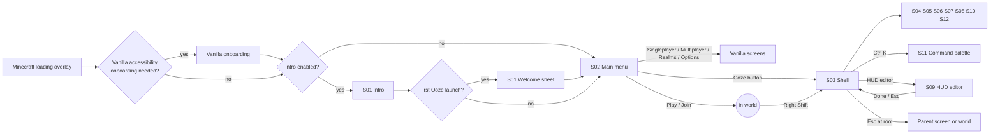

# Ooze Client — User Interaction Flows

> Deliverable 9. End-to-end flows, input routing rules, the Esc precedence chain, and error and recovery flows.

## 1. Navigation map

## 2. Core flows

### F1 — First launch

0. The player signs in and presses Play in the **official Minecraft Launcher**. Ooze plays no part in authentication.
1. The vanilla loading overlay completes. Ooze's async start-up (config, fonts, theme, background) ran in parallel.
2. If Minecraft requires its accessibility onboarding, it shows unchanged first.
3. **S01 Intro** plays (about 1.6 s, skippable).
4. On the first Ooze launch, the **Welcome sheet** opens over S02:
   - ① Theme: live apply.
   - ② Background: live apply, or import an image.
   - ③ Comfort: ClickGUI key, motion level, UI size.
5. **Finish** marks `firstRunComplete` and saves. **Skip** does the same with the defaults.
6. The main menu buttons stagger in. A one-time toast appears: "Press **Right Shift** in a world to open Ooze." (uses the actual bound key).

### F2 — Open the ClickGUI in-world and configure a module

1. In-world, press `Right Shift`. A vanilla `KeyMapping` fires on the client tick, and `ShellScreen` opens with `parent = null`. The world blur and dim fade in, then the window opens.
2. The last visited page is restored (default: the first module category).
3. Click a module card's **toggle**. The module is enabled, the card's icon chip fills with Ink Gel, and the sidebar badge count updates with a squash pulse.
4. Click the card **body**. The inspector slides in and the grid reflows.
5. Adjust a slider. The value applies live; the setting row shows ↺; a save is scheduled (debounced).
6. Click the **Keybind** chip. It enters listening mode; press `K`. If there is a conflict, see F8.
7. Press `Esc` three times:
   - the first closes the inspector;
   - the second goes back if there is history, otherwise closes the shell;
   - when the shell closes, the window close animation runs (140 ms), then the screen closes and the save flushes.

### F3 — Find a setting through search

1. `Ctrl K`. The palette opens with Recent and Suggested.
2. Type "blur". Results appear in under a frame (ARCHITECTURE §12):
   - Setting "World blur" (Settings › ClickGUI);
   - Setting "Blur" (Background › Effects);
   - Action "Open Minecraft blur setting".
3. Arrow down to "Blur (Background)" and press Enter.
4. The palette closes (`ease.exit`). The router navigates to `shell/background`, the window morphs to docked mode, the Effects section scrolls into view with `spring.lazy`, and the Blur row pulses twice.

### F4 — Customise a theme

1. Open Theme from the sidebar.
2. Choose **Ooze Classic** and change the Accent. A modal appears: "Built-in themes can't be changed. Duplicate it as 'Ooze Classic Copy'?" → **Duplicate and edit**.
3. A new user theme is created (`extends: ooze_classic`), selected, and the edit is applied.
4. Pick a pastel accent in the colour picker. The contrast panel shows ⚠ "Text on accent: 2.9 : 1". **Fix** sets `text.onAccent` to ink automatically (or darkens the accent if the user prefers, via the **Adjust accent instead** link).
5. Rename the theme with the ⋯ menu → Rename (modal form).
6. ⋯ → Export writes `mint-copy.theme.json` via file dialog, or the folder fallback with a toast whose **Reveal** action opens the folder.

### F5 — Set a custom background image

1. Main menu → profile chip ⚙, or shell → Background. Docked mode opens.
2. Type: **Image**. Choose **Pick a file…**. The native dialog opens off-thread and the button shows a spinner.
3. The user picks `sunset.png`. The worker validates, hashes, copies, decodes and derives (BACKGROUNDS §4.2). A skeleton tile appears in the library with LiquidProgress while this runs.
4. The image is applied with a 600 ms crossfade. If the image would be upscaled at this resolution, a quality chip is shown.
5. Drag the focal crosshair, set Blur 6 and Dim 15%. The readability badge shows "✓ Readable".
6. Peek (hold `Space`) to view it without UI.
7. Leave the page. The panel morphs back, and the save is flushed.

### F6 — Change fonts

1. Open Typography → Interface font → Font selector → **Inter**.
2. The whole UI re-lays out in one frame. Size normalisation keeps the visual size, and a theme-switch-style crossfade (160 ms) hides the re-layout.
3. Select the **Display** role → Style **Bold**, which uses Inter's real 700 face.
4. Switch to **Bubblegum Sans** and set the Title role to **Italic**. A "Synthesized" chip appears, with the tooltip "Bubblegum Sans has no italic. Ooze is slanting it."

### F7 — Edit the HUD

1. Sidebar → HUD editor ↗. The shell closes and `HudEditorScreen` opens, with world view and no blur.
2. Drag the FPS widget. It lifts (e3); guides appear near the edges or centre; it snaps magnetically.
3. Drop it near the top right. Anchor = `TOP_RIGHT`, and a landing squash plays.
4. Double-click it to open the settings popover. Change Style → Compact.
5. Press `Esc`. This saves and exits. A toast appears: "HUD layout saved", with **Undo**.

### F8 — Keybind conflict resolution

1. Bind a module to `R Ctrl` when another module already uses it. The chip shows the conflict badge.
2. Click the badge. A popover appears: "R Ctrl is also used by Notification Playground." → **Unbind other** / **Keep both**.
3. **Keep both:** both actions fire when the key is pressed (allowed). The warning remains, but in muted styling.
4. Binding a key used by a **vanilla** key mapping shows the same popover, with **Change in Minecraft controls** instead of Unbind other.

### F9 — Profiles

1. Sidebar footer → profile dropdown → **Manage profiles…** goes to Settings › Profiles.
2. **New profile** asks for a name and offers "Start from: Defaults / Copy current".
3. Switching profile:
   - flush pending saves;
   - disable the modules that are enabled now (each disable is applied via the registry);
   - load the target profile's `modules.json` and `hud.json`;
   - enable its modules;
   - send `ProfileChangedEvent`;
   - show the toast "Switched to {name}".
4. Themes, backgrounds, fonts and motion are **global**, not per-profile, in v0.1.

### F10 — Import and export settings

- **Export:** writes a `.ooze-settings.zip` containing `client.json`, `keybinds.json`, the active profile folder, user themes, `backgrounds.json`, and (optionally, via a checkbox) the library images used by the active backgrounds.
- **Import:** pick the file → a **preview** modal lists what will change → **Import** creates a new profile named after the file and leaves the current profile untouched; global settings are replaced only if "Also replace appearance settings" is checked → confirmation toast.

## 3. Input routing rules

### 3.1 Modality

- The **last input event type** sets the modality: `POINTER` or `KEYBOARD`.
- Focus rings show only when the modality is KEYBOARD (focus-visible).
- Hover visuals are suppressed while the modality is KEYBOARD and the pointer has not moved for 1 s.

### 3.2 Pointer dispatch

1. Hit test from the topmost layer down (tooltips are never hit-tested). Within a layer, walk children in reverse paint order.
2. A **modal** layer blocks all layers below it. A click on the scrim equals Cancel unless the modal is `blocking`.
3. **Popovers** close on any press outside them. That press is consumed if it lands on the popover's own trigger (so the trigger toggles it closed), and otherwise passes through.
4. A press starts **pointer capture** on the target. Move, drag and release go to the captor until release.
5. Scroll goes to the innermost scrollable under the pointer. If it is at its limit in that direction, the event bubbles to the parent, except during rubber-band overscroll.

### 3.3 Keyboard dispatch

1. The **focused node** receives the key first (capture phase from root → target, then bubble target → root).
2. **Text fields** consume printable characters and editing keys. Global shortcuts with `Ctrl` still bubble unless the field handles them (Ctrl+A/C/X/V/Z).
3. Global shell shortcuts (S03) are handled at the root during bubbling.
4. In-world, with no screen open, module keybinds are evaluated in `KeyInputEvent` after vanilla processing, and are **never** evaluated while any screen is open (chat, inventory, Ooze screens).

### 3.4 Esc precedence chain

The first applicable step consumes Esc:

1. Keybind chip in listening mode → cancel listening.
2. Open dropdown, popover or context menu → close it.
3. Text field with text in a search context → clear the text. A text field that is empty or not a search field → blur it.
4. Open modal → Cancel (unless `blocking`).
5. Command palette → close it.
6. Inspector open → close it.
7. Docked or studio mode with local history → router back.
8. Router history not empty → back.
9. Otherwise → close the host screen.

### 3.5 Focus management

- Tab order is tree order, overridden by `tabIndex` on a node, with focus **scopes** per region (sidebar, header, content, inspector). `F6` cycles between scopes.
- Composite widgets (segmented controls, radio groups, nav lists, card grids) are **one tab stop** with roving focus via the arrow keys.
- On page change, focus moves to the page's first heading (programmatic and non-visible unless the modality is KEYBOARD). Narration reads the page title.
- On modal close, focus returns to the element that opened the modal. If that element is gone, focus moves to the nearest focusable ancestor.

## 4. Error and recovery flows

| Situation | Behaviour |
|---|---|
| Config file is corrupt on load | Load `file.bak`. If that also fails, use defaults. The corrupt file is renamed `file.corrupt-<timestamp>.json`. A toast appears on the main menu: "Some Ooze settings couldn't be read and were restored from a backup.", with **Show file** |
| Config written by a **newer** Ooze (schema > known) | Read it in **read-only** mode for that file (unknown fields are preserved). Show a warning toast: "These settings are from a newer Ooze version. Changes won't be saved to protect them." **Save anyway** asks for confirmation and writes a backup first |
| Font fails to load | Fall back per the face matcher. A warning toast names the font. The Font selector shows the family as "Unavailable" |
| Image import fails | Inline error in the import tile (no toast). The library is unchanged |
| Background image missing at start-up | Fall back to the default wallpaper for that context. A toast offers **Choose another** |
| Renderer capability check fails (for example, the triangle pipeline cannot be created) | Switch to the degenerate-quad path silently. Log once. The About renderer row shows "(compat)" |
| Module throws in a listener | Catch the exception and log it with the module id. After 3 exceptions within 10 s, auto-disable the module and show the toast "{Module} was turned off after an error." with **Show log** |
| Mixin injection target missing (optional feature) | Disable the feature (for example, module keybinds fall back to KeyMapping polling) and show an About diagnostic entry. **Never crash** for optional features |
| HUD widget off-screen after a resolution change | Clamp it into the safe bounds on load; it keeps its anchor |
| tinyfd unavailable or the dialog fails | Hide **Pick a file…** and show **Open folder** plus the drag-and-drop hint |
| Native engine not bundled, missing, unsupported on this platform, incompatible or failing to load | **Vanilla-only mode** (TARGET_PLATFORM §5): one multi-line log diagnostic with a next step; one vanilla "Ooze Client is off" toast on the first title screen; no Ooze key mappings, screens, HUD or title-screen changes. Implemented and launch-tested in C0 |
